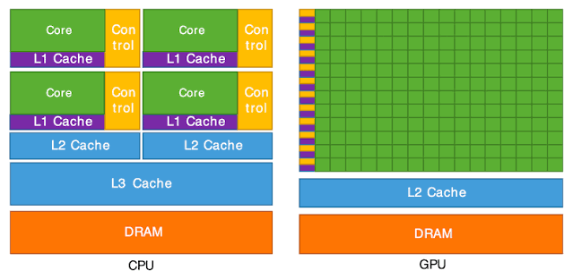

# Understanding GPU basics
As you're probably reading this, you're most likely aware that we're living in the age of the AI boom. Large Language Models like ChatGPT, Claude, Deepseek etc are widely used by a lot of users. However, have you ever sat down and asked yourself in which hardware these LLMs run on?

These LLMS run on specialized chips (processors) known as GPUs(Graphical Processing Units). In this blog I'm tasked with enabling you the reader to understand what a GPU is and how it differs from a CPU(Central Processing Unit).

Without further a do let's begin our quest of understanding what this GPU is.

## 1. GPU vs CPU

